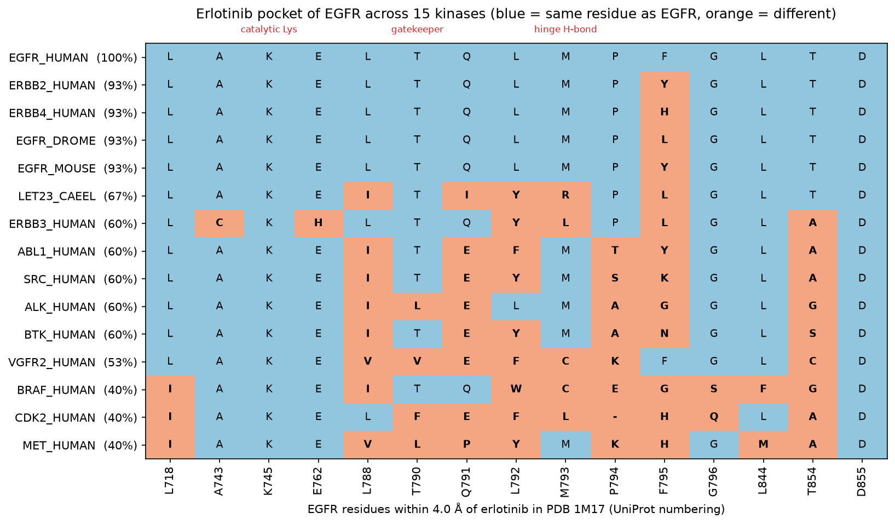

# Practical Biopython Course

**A hands-on, 12-notebook course that takes you from Python basics to sequence analysis, BLAST, alignments, phylogenetics, and protein–ligand structures with Biopython — all in your browser with Google Colab.**

[](https://github.com/hentablihamza/practical-biopython-course/actions/workflows/ci.yml)
[](https://www.python.org)
[](https://colab.research.google.com/github/hentablihamza/practical-biopython-course/blob/main/notebooks/01_python_refresher_biopython_setup.ipynb)

Every notebook runs end to end on free [Google Colab](https://colab.research.google.com) with **one click** — no installation, no setup. The course follows one real drug target from gene to drug-bound structure: **EGFR**, the epidermal growth factor receptor targeted by lung-cancer drugs such as erlotinib and osimertinib. All data are **real, public records** from NCBI, UniProt, and the PDB, and never invented numbers.



*From Notebook 12: the 15 EGFR residues within 4 Å of erlotinib (PDB 1M17), compared across 15 kinases. Catalytic residues such as Lys745 and Asp855 are shared by all of them, while the gatekeeper Thr790 and the hinge region vary: that is where inhibitor selectivity comes from.*

## Who this is for

- **Biology, chemistry, and pharmacy students and Ph.D. researchers** starting in bioinformatics or computational drug discovery.
- **Structural biologists and medicinal chemists** who want to script the sequence and structure work they now do by hand on websites.
- **Programmers** entering the life sciences who want a biology-grounded tour of Biopython.

You need only basic Python. Notebook 01 covers the Python you need; everything else is taught as it appears.

## Syllabus

Click a badge to open that notebook in Colab, or browse the [`notebooks/`](notebooks) folder.

| # | Notebook | You will learn to… | Colab |
|---|----------|--------------------|-------|
| 01 | Python refresher & Biopython setup | use strings, dicts, functions, and pandas on sequences; install Biopython; read a first FASTA file | [](https://colab.research.google.com/github/hentablihamza/practical-biopython-course/blob/main/notebooks/01_python_refresher_biopython_setup.ipynb) |
| 02 | The Seq object | reverse complement, GC content, transcription, translation, six-frame ORFs, codon usage, T790M | [](https://colab.research.google.com/github/hentablihamza/practical-biopython-course/blob/main/notebooks/02_seq_objects.ipynb) |
| 03 | SeqRecord & SeqIO | read, index, filter, convert, and write FASTA and GenBank files | [](https://colab.research.google.com/github/hentablihamza/practical-biopython-course/blob/main/notebooks/03_seqrecord_seqio.ipynb) |
| 04 | Sequence features & annotations | walk GenBank features, extract the CDS, map residues to codons and exons, draw a feature map | [](https://colab.research.google.com/github/hentablihamza/practical-biopython-course/blob/main/notebooks/04_sequence_features_annotations.ipynb) |
| 05 | NCBI Entrez | esearch / esummary / efetch on Nucleotide and PubMed, politely and with an offline cache | [](https://colab.research.google.com/github/hentablihamza/practical-biopython-course/blob/main/notebooks/05_ncbi_entrez.ipynb) |
| 06 | Pairwise alignment | PairwiseAligner, BLOSUM62, affine gaps, global vs local, identity matrix of drug-target kinases | [](https://colab.research.google.com/github/hentablihamza/practical-biopython-course/blob/main/notebooks/06_pairwise_alignment.ipynb) |
| 07 | Multiple sequence alignment | AlignIO, conservation (entropy), consensus, binding-site residues across kinases | [](https://colab.research.google.com/github/hentablihamza/practical-biopython-course/blob/main/notebooks/07_multiple_sequence_alignment.ipynb) |
| 08 | BLAST | qblast at NCBI, parse XML with NCBIXML, build and filter a hit table | [](https://colab.research.google.com/github/hentablihamza/practical-biopython-course/blob/main/notebooks/08_blast_search_parsing.ipynb) |
| 09 | Protein analysis | ProtParam (MW, pI, ε280, instability, GRAVY), hydropathy, motifs, Bio.motifs | [](https://colab.research.google.com/github/hentablihamza/practical-biopython-course/blob/main/notebooks/09_protein_analysis.ipynb) |
| 10 | Protein structures with Bio.PDB | EGFR–erlotinib (PDB 1M17): hierarchy, numbering, distances, binding site, B-factors, SASA | [](https://colab.research.google.com/github/hentablihamza/practical-biopython-course/blob/main/notebooks/10_protein_structure_biopdb.ipynb) |
| 11 | Phylogenetics | distance matrices, UPGMA & neighbour-joining trees, rooting, Newick, bootstrap support | [](https://colab.research.google.com/github/hentablihamza/practical-biopython-course/blob/main/notebooks/11_phylogenetics.ipynb) |
| 12 | Mini project: target → structure | UniProt → sequence → BLAST → alignment → PDB → binding-pocket conservation and selectivity | [](https://colab.research.google.com/github/hentablihamza/practical-biopython-course/blob/main/notebooks/12_mini_project_target_to_structure.ipynb) |

Each notebook has clear **learning objectives**, explanations in Markdown, runnable code, and **exercises with collapsible solutions**. Work them in order — later notebooks reuse ideas and data from earlier ones.

## How to use it

### Option 1 — Google Colab (recommended, nothing to install)

Click any **Open in Colab** badge above. The first cell installs Biopython and downloads the course data automatically.

### Option 2 — Run locally

```bash
git clone https://github.com/hentablihamza/practical-biopython-course.git
cd practical-biopython-course

# with conda
conda env create -f environment.yml
conda activate practical-biopython-course

# or with pip
pip install -r requirements.txt

jupyter notebook   # open the notebooks/ folder
```

### Online and offline

Notebooks 05 (NCBI Entrez), 10 (PDB download), and 12 (UniProt) query live web services when they can and **fall back automatically** to cached copies in [`data/`](data) when there is no internet. Notebook 08 reads a cached BLAST result by default because remote BLAST jobs can wait in NCBI's queue for many minutes; flip `RUN_LIVE_BLAST = True` to submit your own. Set the environment variable `COURSE_OFFLINE=1` to force the cached path everywhere (this is what CI does).

When you use NCBI, set `Entrez.email` to your own address, as NCBI's usage policy asks (Notebook 05 explains the rules).

## Datasets

Small, real, public datasets are committed under [`data/`](data) with full provenance in [`data/README.md`](data/README.md) and retrieval dates in [`data/provenance.json`](data/provenance.json):

- **UniProt** sequences of 15 protein kinases (human ErbB family, EGFR orthologues, and drug targets such as ABL1, BTK, BRAF, ALK) plus EGFR feature annotations.
- **NCBI RefSeq** EGFR mRNA `NM_005228.5` (GenBank and FASTA) and cached Entrez search results.
- A cached **BLAST** search of the EGFR kinase domain against Swiss-Prot.
- A **multiple sequence alignment** of the 15 kinase domains (FAMSA).
- **PDB 1M17**: EGFR kinase domain bound to erlotinib (mmCIF and PDB formats).

Refresh everything from the original sources with [`scripts/refresh_cache.py`](scripts/refresh_cache.py).

## Related open-source projects

This course is part of a small set of open tools and courses for computational drug discovery:

- **[practical-cheminformatics-course](https://github.com/hentablihamza/practical-cheminformatics-course)** — the companion course: 12 Colab notebooks from RDKit basics to QSAR and virtual screening.
- **[chembl-easy](https://github.com/hentablihamza/chembl-easy)** — one-command clean, ML-ready bioactivity downloads from ChEMBL (e.g. for the EGFR target used here).
- **[chem-curate](https://github.com/hentablihamza/chem-curate)** — reproducible bioactivity and structure curation for QSAR.
- **[qsar-split-bench](https://github.com/hentablihamza/qsar-split-bench)** — benchmark random, scaffold, cluster, and time splits to detect data leakage.

## Author

**Hamza Hentabli, Ph.D.** — AI/ML drug discovery & cheminformatics scientist, and former teacher who has mentored Ph.D. and master's students. This course distills that teaching into material anyone can run.

- GitHub: [@hentablihamza](https://github.com/hentablihamza)
- Google Scholar: [publications](https://scholar.google.com/citations?user=-7dUlnMAAAAJ)
- ORCID: [0000-0002-9530-2815](https://orcid.org/0000-0002-9530-2815)

If these materials help your work or teaching, please cite them (see [`CITATION.cff`](CITATION.cff)). Issues and suggestions are welcome.
